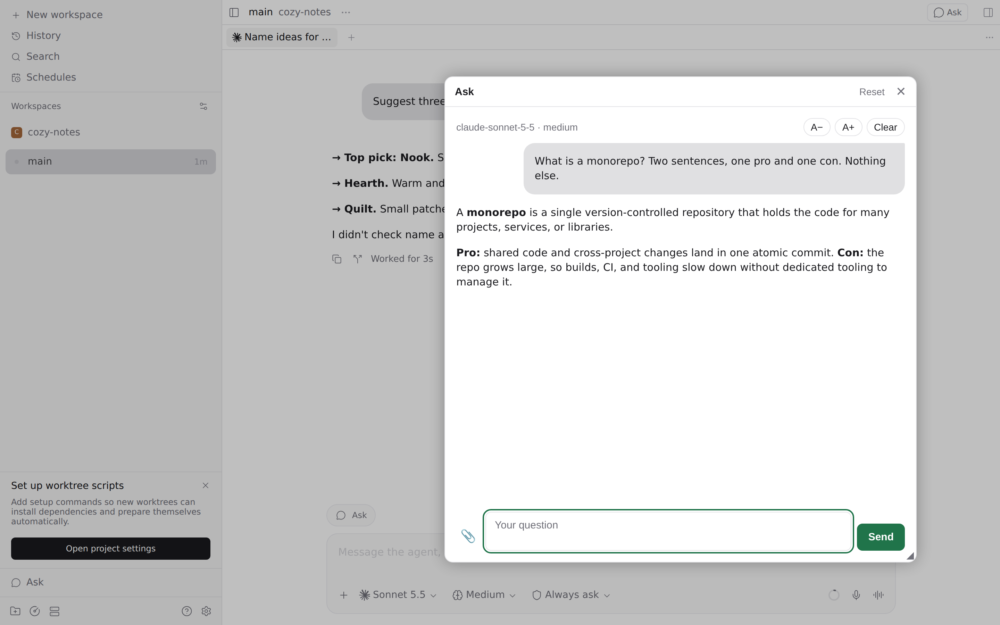
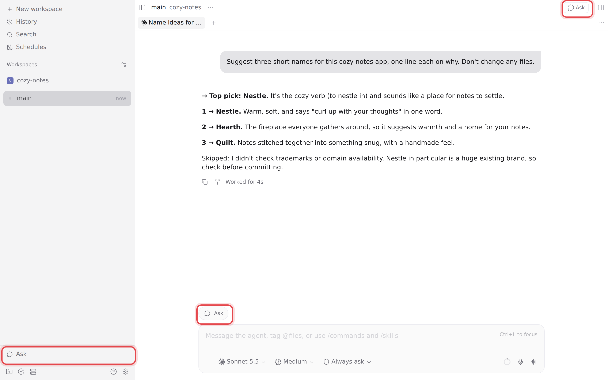
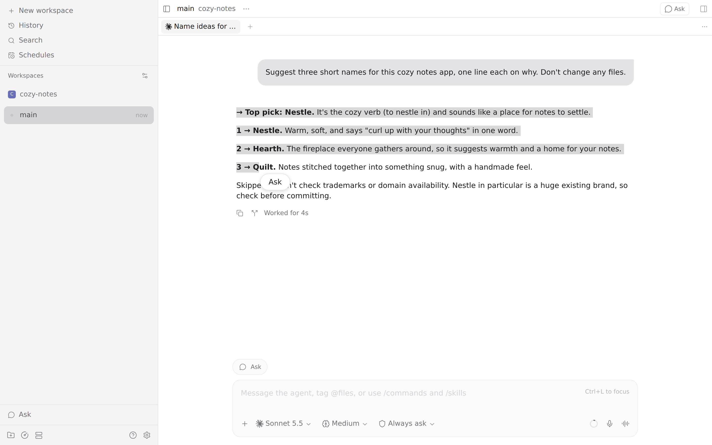

# Ask — a Paseo plugin

A floating window for quick questions, answered by Claude on the daemon.

Open it from the "Ask" row in the sidebar footer or the "Ask" button in an agent's composer. Follow-ups stay in the same thread. It also has a button in the workspace header, which works in a new-agent draft too. On phones it opens full screen; on desktop it can be moved and resized, and you can paste images or attach files. Select text anywhere in Paseo for a small Ask button that quotes it; click an attached image to view it full size.







**Runs with full access.** Each question runs `claude -p --permission-mode bypassPermissions` in your home directory on the daemon, with your Claude Code settings, skills and MCP servers: it can read and change files and run commands without asking. Questions, the thread and anything Claude reads go to Anthropic through your Claude Code login.

## Install

Requires Paseo 0.13.0 or later, and the `claude` CLI installed and logged in on the daemon machine.

```bash
paseo plugin install https://github.com/puchkoff/paseo-ask
```

Or from a local clone: `paseo plugin install ./paseo-ask`. Check with `paseo plugin ls`.

## Develop

```bash
npm install
npm run typecheck
npm test
```

The in-app description shown by Paseo lives in [OVERVIEW.md](OVERVIEW.md).
