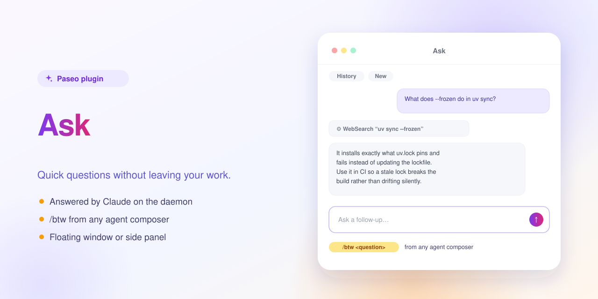

# Ask — a Paseo plugin



A floating window for quick questions, answered by Claude on the daemon.

Click "Ask" in the workspace header or in an agent's composer, or type `/btw <question>` in a composer to send the question to Ask instead of the agent. Follow-ups stay in the same thread, and "History" keeps your last 100 conversations.

Select text anywhere in Paseo to ask about it. In an agent's chat you also get "Quote", which drops the text into that agent's message box, and "Ask in new chat", which starts a new agent with this chat's history.

Ask opens as a floating window or as a tab in the right-hand panel (Settings → Plugins → paseo-ask → ⋯ → Ask). On desktop you can move and resize the window, paste images and attach files.


**Runs with full access.** Each thread runs `claude -p --permission-mode bypassPermissions` in your home directory on the daemon, with your Claude Code settings, skills and MCP servers. It can read and change files and run commands without asking. Quoted text can carry instructions, for example from a web page an agent read, and Claude may follow them. Your questions and everything Claude reads go to Anthropic through your Claude Code login.

## Install

Requires Paseo 0.13.0 or later, and the `claude` CLI installed and logged in on the daemon machine.

```bash
paseo plugin install https://github.com/puchkoff/paseo-ask
```

Or from a local clone: `paseo plugin install ./paseo-ask`. Check with `paseo plugin ls`.

## Develop

```bash
npm install
npm run typecheck
npm test
```

The in-app description shown by Paseo lives in [OVERVIEW.md](OVERVIEW.md).
